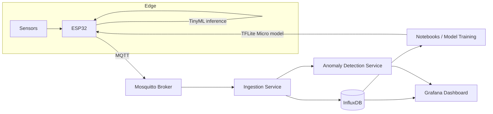

# Edge Anomaly Detection

> End-to-end IoT anomaly detection: from sensor data collection on an ESP32 to unsupervised and deep learning models — and back to the microcontroller with on-device (TinyML) inference.


## Overview

This project builds a home environment monitoring system that learns what "normal" looks like and flags unusual behavior in real time — without labeled data.

It is developed incrementally alongside my postgraduate studies in Applied Artificial Intelligence (UNISINOS), covering **unsupervised learning**, **deep neural networks**, and **IoT / Big Data**, and builds on my previous research in Edge AI performance and energy efficiency.

**Goals**

- Collect real-world, multivariate sensor data from an ESP32-based monitoring hub
- Compare classical unsupervised anomaly detection methods with deep learning approaches
- Deploy a quantized model directly on the ESP32 and measure the trade-offs between accuracy, latency, memory, and energy
- Visualize sensor data and detected anomalies on a real-time dashboard

## Architecture



## Roadmap

### Phase 1 — Data Collection
- [ ] ESP32 firmware publishing sensor readings over MQTT
- [ ] Dockerized infrastructure (Mosquitto + InfluxDB)
- [ ] Ingestion service persisting readings to the time-series database
- [ ] Anomaly log: manually recorded events (e.g., heating the sensor, opening windows) used as ground truth for evaluation

### Phase 2 — Classical Unsupervised Learning
- [ ] Exploratory data analysis and feature engineering (rolling statistics, time-of-day features)
- [ ] Dimensionality reduction for visualization (PCA, UMAP)
- [ ] Clustering to identify operating modes (K-Means, GMM, DBSCAN)
- [ ] Anomaly detection baselines (Isolation Forest, Local Outlier Factor)

### Phase 3 — Deep Learning
- [ ] Dense autoencoder baseline
- [ ] LSTM autoencoder for time-series reconstruction
- [ ] Threshold selection based on reconstruction error
- [ ] Comparison against Phase 2 baselines

### Phase 4 — On-Device Inference (TinyML)
- [ ] Model quantization (int8) and conversion to TensorFlow Lite Micro
- [ ] On-device inference on the ESP32
- [ ] Benchmark: accuracy vs. latency vs. memory footprint vs. energy consumption

### Phase 5 — Real-Time Dashboard & Alerts
- [ ] Grafana dashboard with live sensor data and anomaly markers
- [ ] Alerting on detected anomalies
- [ ] One-command deployment with Docker Compose

## Results

*To be updated as each phase is completed.*

| Model | Runs on | Precision | Recall | F1 | Latency | Model Size |
|---|---|---|---|---|---|---|
| Isolation Forest | Server | – | – | – | – | – |
| Local Outlier Factor | Server | – | – | – | – | – |
| LSTM Autoencoder | Server | – | – | – | – | – |
| LSTM Autoencoder (int8) | ESP32 | – | – | – | – | – |

## Tech Stack

| Layer | Technologies |
|---|---|
| Hardware | ESP32-S3, BMP280 (temperature/pressure), BH1750 (light), PIR motion sensor |
| Firmware | C++ (Arduino IDE), TensorFlow Lite Micro |
| Messaging | MQTT (Mosquitto) |
| Storage | InfluxDB |
| ML | Python, NumPy, pandas, scikit-learn, TensorFlow / Keras |
| Visualization | Matplotlib, Grafana |
| Infrastructure | Docker, Docker Compose |

## Hardware & Wiring

Board: **ESP32-S3 DevKitC-1** (N16R8 recommended: 16 MB flash, 8 MB PSRAM). The S3's vector instructions accelerate int8 TensorFlow Lite Micro kernels via ESP-NN, and the PSRAM leaves room for larger models in Phase 4.

| Sensor | Measures | Interface |
|---|---|---|
| BMP280 | Temperature (°C), barometric pressure (hPa) | I2C (0x76 / 0x77) |
| BH1750 | Ambient light (lux) | I2C (0x23 / 0x5C) |
| PIR (HC-SR501 or AM312) | Motion | Digital GPIO |

Both I2C sensors share the same bus (SDA/SCL lines wired in parallel).

| Sensor pin | ESP32-S3 pin | Notes |
|---|---|---|
| BMP280 VCC | 3V3 | Do not use 5V on bare modules |
| BMP280 GND | GND | |
| BMP280 SDA | GPIO 8 | Shared I2C data |
| BMP280 SCL | GPIO 9 | Shared I2C clock |
| BH1750 VCC | 3V3 | |
| BH1750 GND | GND | |
| BH1750 SDA | GPIO 8 | Shared I2C data |
| BH1750 SCL | GPIO 9 | Shared I2C clock |
| BH1750 ADDR | GND or unconnected | Address 0x23 (tie to 3V3 for 0x5C) |
| PIR VCC | 5V for HC-SR501 / 3V3 for AM312 | |
| PIR GND | GND | |
| PIR OUT | GPIO 4 | 3.3V logic output, safe for the ESP32-S3 |

```
             ESP32-S3 DevKitC-1
            ┌───────────────┐
  3V3 ──────┤ 3V3           │
  GND ──────┤ GND           │
            │        GPIO 8 ├──┬── SDA (BMP280)
            │               │  └── SDA (BH1750)
            │        GPIO 9 ├──┬── SCL (BMP280)
            │               │  └── SCL (BH1750)
            │        GPIO 4 ├───── OUT (PIR)
  5V ───────┤ 5V            │      (PIR VCC, if HC-SR501)
            └───────────────┘
```

Avoid GPIO 0, 3, 45, 46 (strapping), 19, 20 (USB) and 35–37 (used by octal PSRAM). Pins are configurable in `firmware/edge_sensor_hub/config.h`. See [firmware/README.md](firmware/README.md) for build and upload instructions.

## Project Structure (planned)

```
.
├── firmware/            # ESP32 code (sensor reading, MQTT, on-device inference)
├── infra/               # Docker Compose, Mosquitto and InfluxDB configuration
├── ingestion/           # Service that consumes MQTT messages and stores readings
├── notebooks/           # EDA, clustering, anomaly detection experiments
├── models/              # Training scripts and exported models
├── dashboard/           # Grafana provisioning and dashboards
├── data/                # Sample datasets and anomaly event log
└── docs/                # Architecture diagrams, benchmark results, demo media
```

## Getting Started

*Setup instructions will be added as the components are implemented.*

```bash
git clone https://github.com/guustavomc/Edge-Anomaly-Detection.git
cd Edge-Anomaly-Detection
docker compose -f infra/docker-compose.yml up -d
```

## Related Work

- **EdgeAIMetric** — Benchmark for performance and energy consumption evaluation of single-board computers in Edge AI environments (B.S. thesis, UNISINOS)
- Publications at IoTBDS 2026 and ERAD-RS 2025

## Author

**Gustavo M. Conceição** — Software Engineer at SAP, postgraduate student in Applied Artificial Intelligence

[GitHub](https://github.com/guustavomc)

## License

This project is licensed under the MIT License.